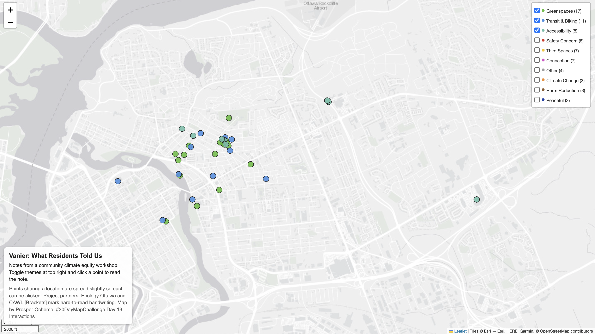

# Vanier: What Residents Told Us
#30DayMapChallenge 2026, Day 13: Interactions

### [▶ Open the interactive map](https://prosperocheme.github.io/vanier-day13-map/)

An interactive map of 70 geolocated notes from the Vanier neighbourhood mapping workshop, collected June 2026 for Ecology Ottawa's climate equity mapping project.

## How to use it
- Use the layer list (top right) to switch themes on and off. The map opens with Greenspaces, Transit & Biking, and Accessibility showing.
- Click a point to read the resident's note.
- Points that share a location are spread slightly so each can be clicked.
- [Brackets] mark hard-to-read handwriting.

## About the project
Project partners: Ecology Ottawa and CAWI. Full story: [Vanier StoryMap](https://storymaps.arcgis.com/stories/f3e830b617d04fc8aeff4e54b8ef71fe)

## Built with
Python, pandas, Folium (Leaflet), and Plotly in Google Colab. Basemap tiles © Esri.

Map by Prosper Ocheme.
